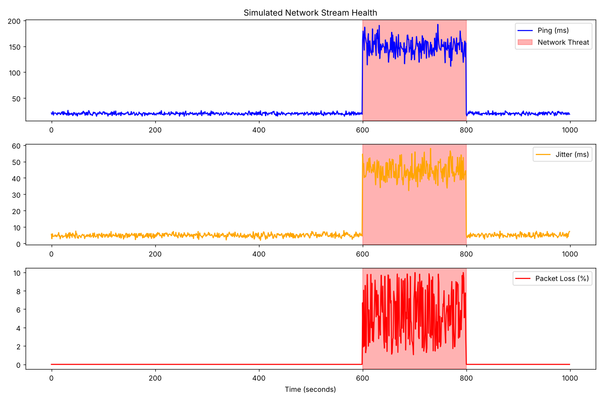
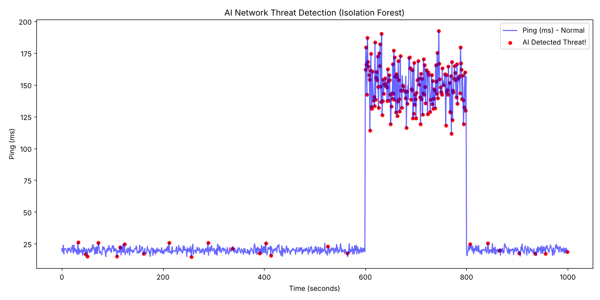
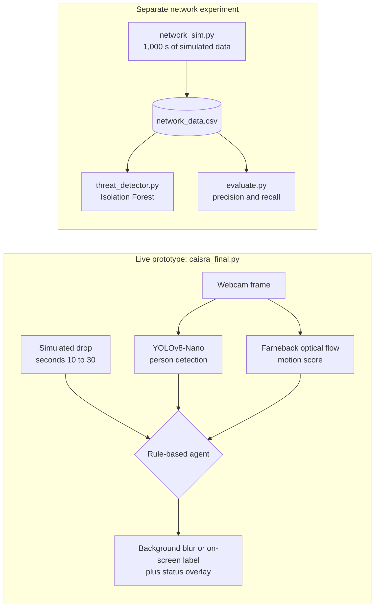

# CAISRA: Content-Aware Intelligent Stream Routing Agent

A webcam prototype that simulates content-aware compression during network drops, keeping only the detected person sharp. Personal project, 2026.

## The Problem

When a live stream loses bandwidth, the usual response is to lower the quality of the whole frame, so the viewer loses detail everywhere, including the person they are watching. CAISRA instead keeps the important region sharp and gives up detail in the rest.

## Approach

- **Scene sensing:** YOLOv8-Nano person detection (COCO-pretrained, not retrained) and optical-flow motion scoring (Farneback).
- **Decision:** a rule-based agent with 3 actions. During a network drop in a still shot, it keeps the person sharp and blurs the background, as a visual stand-in for compression.
- **Key decision:** protect the person instead of degrading the full frame, which was rejected because it blurs the person too.
- **Separate experiment:** an Isolation Forest trained on 1,000 seconds of simulated ping, jitter, and packet-loss data to flag outages. It is not connected to the live prototype, where the drop is a fixed timer.

## Results

On simulated data, the Isolation Forest flags outages with 0.88 precision and recall; a one-line packet-loss rule scores 1.00. Measured by `evaluate.py` on the committed `network_data.csv`, where the simulator injected an outage from second 600 to 799 (200 of 1,000 seconds):

| Method | Seconds flagged | True positives | False positives | Precision | Recall |
|---|---|---|---|---|---|
| Isolation Forest | 200 | 176 | 24 | 0.88 | 0.88 |
| Rule: packet loss > 0 | 200 | 200 | 0 | 1.00 | 1.00 |

What this means: in this simulation, packet loss is exactly 0 outside the outage, so a one-line rule finds every outage second with no false alarms, and the Isolation Forest does worse. The model was also given the outage share (`contamination=0.2`, which is 200 of 1,000 seconds), and it was trained and scored on the same data. It has not been tried on real network traces.



*The simulated network data. The injected outage (shaded) raises ping and jitter and adds packet loss.*



*The seconds the Isolation Forest flags (red). The 24 red points outside the outage, before second 600 and after second 799, are false alarms. Both figures are drawn from the committed `network_data.csv`.*

The live prototype has no measured results yet: frame rate, bandwidth saved, and image quality were not measured.

## How It Works



The two parts do not exchange data. During the simulated drop, the agent picks one of 3 actions:

| Person in frame | Motion score | Action | What happens |
|---|---|---|---|
| Yes | below 3.0 | `SMART_COMPRESSION` | Background blurred (21×21 Gaussian), person box kept sharp |
| No | above 3.0 | `SCENERY_MODE` | On-screen label only: protect the wide shot |
| Any other case | | `DYNAMIC_ROUTING` | On-screen label only: switch to a backup server |

Outside the drop, the action is `NORMAL`. An overlay at the top of the window shows the time, network status, motion score, and current action.

## Quickstart

Requires Python 3.8+ and a webcam.

```bash
git clone https://github.com/OMH-sa/CAISRA.git && cd CAISRA
pip install opencv-python ultralytics scikit-learn pandas matplotlib
python caisra_final.py
```

Press `q` to quit. The simulated drop starts at second 10 and ends after second 30. Sit still to see the background blur; leave the frame and move the camera to see the scenery mode.

The network experiment needs no webcam:

```bash
python threat_detector.py   # trains the Isolation Forest and plots the flagged seconds
python evaluate.py          # prints the Results table above
```

`network_sim.py` overwrites `network_data.csv` with new random values, because it has no fixed seed. The Results above use the committed file.

## Project Structure

| File | What it does |
|---|---|
| `caisra_final.py` | The live prototype: webcam, person detection, motion score, simulated drop, agent, blur, and overlay |
| `sensor.py` | Earlier stand-alone version of the scene sensing (person box and motion score), without the agent |
| `agent.py` | Earlier stand-alone version of the decision rules (2 actions plus normal) on 9 scripted events; not used by `caisra_final.py` |
| `network_sim.py` | Generates 1,000 seconds of simulated network data with one injected outage and saves `network_data.csv` |
| `network_data.csv` | The simulated network data used for the Results |
| `docs/` | The two figures in Results, drawn from `network_data.csv` |
| `threat_detector.py` | Trains the Isolation Forest and plots the seconds it flags |
| `evaluate.py` | Scores the Isolation Forest and a packet-loss rule against the injected outage |
| `yolov8n.pt` | Official Ultralytics YOLOv8-Nano weights, pretrained on COCO, unchanged |

## Data

- **Network data is simulated, not recorded.** `network_sim.py` draws one row per second for 1,000 seconds: ping around 20 ms, jitter around 5 ms, and no packet loss. From second 600 to 799 it injects an outage: ping about 130 ms higher, jitter about 40 ms higher, and packet loss between 1% and 10%.
- **Video:** the live webcam feed. No video files are stored or shipped.
- **Model:** `yolov8n.pt` is identical to the YOLOv8-Nano file Ultralytics publishes, pretrained on COCO, where class 0 is `person`. Ultralytics licenses it under AGPL-3.0.

## Limitations

- The network data is simulated; the detector has never seen real traffic.
- In the live prototype the drop is a fixed timer. The Isolation Forest is not connected to it.
- The Isolation Forest is trained and scored on the same 1,000 seconds and is given the outage share. On this data a simple packet-loss rule does better.
- Compression is simulated with a blur. Nothing is encoded, transmitted, or rate-limited.
- The two routing actions only show a label; there is no backup server.
- The rules use one fixed motion threshold (3.0) that was not tuned on data.
- Only the first detected person is protected, and the protected area is the whole body box, not the face.
- An empty, still scene during a drop also falls into `DYNAMIC_ROUTING`, the catch-all rule.
- Frame rate was not measured, and there are no automated tests yet.
- This is a prototype for exploring the idea, not a production system.

## Tech Stack

Python · OpenCV · YOLOv8 (Ultralytics) · scikit-learn · pandas · NumPy · Matplotlib

## Author

**Osama Hurubi** · [LinkedIn](https://www.linkedin.com/in/osama-hurubi) · [GitHub](https://github.com/OMH-sa)
